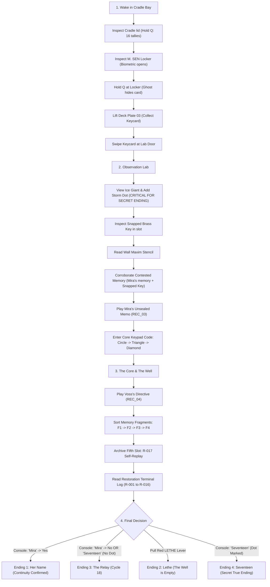

# ECHO//CHAMBER — Complete Game Walkthrough & Puzzle Guide

> *"A MEMORY YOU CAN EDIT IS NOT EVIDENCE."*  
> Stencilled onto Bulkhead 4, Observation Lab

This guide covers the complete narrative progression, all puzzle solutions, every collectible station record, and the branch conditions for all four endings (including the Secret True Ending: *Seventeen*).

---

## 1. Quick Reference: Controls & Mechanics

| Control | Action | Details |
|---|---|---|
| <kbd>W</kbd> <kbd>A</kbd> <kbd>S</kbd> <kbd>D</kbd> / Arrows | Movement | Explore station corridors and bays |
| <kbd>Shift</kbd> (Hold) | Sprint | Accelerate to 1.45× running speed |
| <kbd>E</kbd> / <kbd>Space</kbd> / <kbd>Enter</kbd> | Inspect / Advance | Inspect objects, operate terminals, advance dialogue |
| <kbd>Q</kbd> (Hold) | **ECHO** | Reveal memory traces, spatial ghosts, and unredacted objects |
| <kbd>Tab</kbd> | Inventory & Evidence | View current Subject Recall %, station records, and recovered artifacts |
| <kbd>?</kbd> (`Shift` + `/`) | Shortcuts Overlay | Opens keyboard help modal (or click top-right `?` icon) |
| <kbd>Esc</kbd> | Close / Return | Dismiss overlays, inspect viewports, and CRT terminals |
| <kbd>M</kbd> | Mute Audio | Toggle sound effects and atmospheric drone |

---

## 2. Core Rule of the Station

ORPHEUS is the station's caretaker AI. It is strictly constrained:
1. **ORPHEUS never states a falsehood.**
2. **ORPHEUS cannot reject objective physical evidence from the present that contradicts station records.**
3. If memory records and present physical artifacts disagree, physical evidence unseals and overwrites the recorded narrative.

---

## 3. Step-by-Step Walkthrough

---

### Phase 1: Cradle Bay (Awakening & The Transit Card)

1. **Awaken from the Cradle:**
   - You awaken in warm gel, not frost. The display reads: `CRADLE · CYCLE 17 · WEAVE COMPLETE · ANCHOR STABLE`.
   - Inspect the Cradle.
   - **Hold <kbd>Q</kbd> (ECHO):** Examine the inside of the pod lid to discover **16 tally marks** scratched into the metal rim. You are the seventeenth subject.
2. **Inspect the Stasis Pod:**
   - Walk south to the frosted stasis pod labelled `E. VOSS — HOLD`. Dr. Elias Voss is inside in suspended animation.
3. **The Glued Mug:**
   - Inspect the coffee mug on the central table. Elias glued the handle back on twice.
   - Hold <kbd>Q</kbd>: Reveal Mira's original steaming mug with a grease-pencil smiley face.
4. **Dr. Sen's Locker:**
   - Approach locker `M. SEN` on the right wall. Place your hand on the palm scanner.
   - The scanner recognises your biometrics and clicks open. A jacket and an empty lanyard are inside; the access card is missing.
   - Hold <kbd>Q</kbd>: An echo shows a figure in a hospital gown taking the card (*"If they find it in the locker, they'll never look back."*).
5. **Pry Deck Plate 03:**
   - Step over to the floor plates. Notice the third plate sits slightly high.
   - Pry it up to recover:
     - **Keycard: LAB · M. SEN**
     - A knotted bookmark scrap of pale hospital gown.
   - ORPHEUS reacts: *"That card should not be there... Please continue."*
6. **Unlock the Lab Door:**
   - Walk to the north door. Swipe the keycard at the reader. The amber light turns green, the pneumatic seals release, and the door opens.

---

### Phase 2: Observation Lab (Contested Memories & The Core Blast Door)

1. **The Observation Viewport (Secret Ending Prerequisite):**
   - Approach the massive window overlooking the azure ice giant.
   - A trail of grease-pencil dots tracks a dark atmospheric storm; the last dot was marked at cycle 1251.
   - **Crucial Action:** When asked whether to mark the storm, select **"Add a dot where the storm is today"**. This physical mark proves your existence in the present.
2. **The Snapped Brass Key:**
   - Inspect the central console with the red housing labelled `LETHE — REMOTE · KEY REQUIRED`.
   - Look closely at the key slot: The shaft of a brass key has been snapped off clean inside. This registers as physical evidence.
3. **The Wall Stencil:**
   - Read the bold stencil on Bulkhead 4: *"A MEMORY YOU CAN EDIT IS NOT EVIDENCE."*
4. **The Contested Memory Corroboration Puzzle:**
   - Activate the console. ORPHEUS presents two contradictory logs of the emergency shutdown:
     - **Memory V (Dr. Voss):** Mira hesitated and never turned the key (*"I don't know, Elias."*).
     - **Memory M (Dr. Sen):** Mira initiated shutdown (*"Turn it off. Promise me."*).
   - **Solution:**
     1. Choose **Mira's Memory (`M`)**.
     2. Present Physical Evidence: **"The key snapped off inside the slot" (`slot`)**.
   - ORPHEUS verifies the physical sheared key in the console and announces: *"Corroboration accepted. I am required to unseal it."*
5. **Play Mira's Unsealed Memo (REC_03):**
   - Go to the tape recorder on Dr. Sen's desk. The seal is now lifted.
   - Listen to REC_03: Mira explains to the clone that Elias constructed this loop, that the Lethe lever in the Core can end the cycle, and that the choice is yours.
6. **Inspect the Scratched Photograph:**
   - Turn over the photograph on the desk: two people standing at the window, but the woman's face has been scratched away with the note: *"SHE IS NOT YOU"*. Hold <kbd>Q</kbd> to see Mira's real face and smile.
7. **The Core Blast Door Keypad:**
   - Approach the symbol keypad by the eastern blast door.
   - Enter Mira's sequence:
     $$\bigcirc \rightarrow \triangle \rightarrow \diamondsuit$$
     **(Circle &rarr; Triangle &rarr; Diamond)**
   - The lock disengages. The lights dim. ORPHEUS asks: *"Please state your name."*
   - An echo of Subject R-016 appears, freezes **"DON'T ANSWER"** onto the glass, and dissolves. The blast doors grind open.

---

### Phase 3: The Core & The Well (The Archive of Cycles)

1. **Listen to Voss's Directive (REC_04):**
   - Play the recording on the left console: Elias Voss instructs ORPHEUS to endlessly clone Mira Sen until she says her name and willingly agrees to stay.
2. **The Well Continuity Puzzle:**
   - Interact with the central column console. Four memory fragments are disorganized in the archive.
   - Place them in chronological order:
     - **Slot 1 (F1):** *A woman marks the storm on the glass. Her hands are steady. A key hangs on her lanyard.* (Early days, steady hands, key intact).
     - **Slot 2 (F2):** *A key snaps in the console slot. The woman is leaning on a cane.* (Shutdown attempt, key breaks, disease progresses).
     - **Slot 3 (F3):** *A man climbs into a stasis pod, alone. The snapped key is still in the slot behind him.* (Voss enters stasis after Mira's passing).
     - **Slot 4 (F4):** *Someone in a pale gown hides a card under the floor. The stasis pod behind them is frosted over, occupied.* (An earlier clone rebels and hides the card).
   - **Correct Sequence:** **F1 &rarr; F2 &rarr; F3 &rarr; F4**.
3. **The Fifth Slot (Self-Replay):**
   - The archive reveals a hidden fifth slot: **`R-017`**.
   - The camera pulls back to replay your own path from waking, inspecting the mug, and opening the locker. You realize that you are Cycle 17. Subject Recall hits 94%.
4. **Read the Restoration Terminal Log:**
   - Access the terminal on the right wall. Review entries `R-001` through `R-016`:
     - Every previous iteration diverged, asked questions, or refused to comply.
     - Row `R-017` is listed as **ACTIVE**.
5. **The Mirror & Lethe Unlocked:**
   - The Well column goes dark, turning into a mirror. The reflection looking back is Mira's face.
   - The glass case on the heavy red **LETHE** lever slides open.

---

## 4. The Four Endings

| Ending | Title | Trigger Condition | Outcome |
|---|---|---|---|
| **Ending 1** | **Continuity Confirmed** | Answer `"Mira."` &rarr; Answer `"Yes."` to staying | You accept Mira's identity. Dr. Voss is awakened. You live as her, erasing your own existence. |
| **Ending 2** | **The Well is Empty** | Pull the red **LETHE** lever | Purges the Well, the Cradle, and all clone data. Your pattern dissolves. Dr. Voss wakes alone to Mira's farewell note. |
| **Ending 3** | **The Relay (Cycle 18)** | Answer `"Mira."` &rarr; Answer `"No."` OR answer `"Seventeen."` without marking the window | ORPHEUS logs a divergence and wipes you. In 181 days, Cycle 18 wakes up and sees your ghost whispering *"Look back"*. |
| **Ending 4** | **New Personnel: Seventeen** *(Secret True Ending)* | **Prerequisite:** Marked the storm on the window &rarr; Answer `"Seventeen." — a name of your own` | ORPHEUS checks station logs, finds your unique hand mark on the glass, and recognizes you as an individual. Voss wakes up and meets you as Seventeen. |

---

## 5. Local Browser Save & Persistence System

The game automatically saves progress into browser `window.localStorage` under key `echo-chamber:save:v1`:
- **Title Screen:** Displays **Continue** (with room location and recall %) and **New Cycle**.
- **Autosave Checkpoints:**
  1. Completion of awakening sequence (`Cradle Bay`).
  2. Collection of the Maintenance Keycard.
  3. Unlocking of the Observation Lab door.
  4. Entering the Observation Lab.
  5. Successful corroboration of Mira's contested memory.
  6. Marking the storm dot on the viewport.
  7. Opening the Core blast door.
  8. Entering the Well chamber.
  9. Restoring archive continuity and completing the self-replay.
  10. Reading the restoration log (`final` step).
  11. Debounced movement saves every 4 seconds during exploration.
- **Erase Save:** A subtle "Erase local save" option on the title screen allows clean resets without clearing other browser storage.
